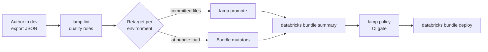

# Lamp Ops

<p align="center"></p>

Lamp Ops (`lamp`) helps you ship Databricks AI/BI dashboards and Genie agents
through dev, test, and prod with Databricks Asset Bundles (DABs). Author an asset
once in your source environment; Lamp retargets it for every other environment
and checks it before it reaches users.

| You want to… | Use |
|---|---|
| Write environment-specific copies of dashboard and Genie JSON | [`lamp promote`](#promotion) |
| Retarget assets at deploy time without generated files | [Bundle mutators](#bundle-mutators) |
| Check Genie agents against quality rules | [`lamp lint`](#linting) |
| Enforce platform rules on whole bundles in CI | [`lamp policy`](#bundle-policies) |

## How it fits together



1. Build the dashboard or Genie agent in the source environment (usually `dev`)
   and export its JSON, for example with `databricks bundle generate`.
2. `lamp lint` checks the source definitions, optionally enriched with Unity
   Catalog metadata.
3. Retarget for each environment, either by writing files with `lamp promote` or
   in memory with the bundle mutators. Both use the same replacement engine;
   promotion reads the Lamp configuration, the mutators a bundle variable.
4. In CI, `lamp policy` checks the rendered bundle summary before deployment.

Each step is optional: use only promotion, only linting, or only policies.

## Contents

<!-- BEGIN GENERATED TOC -->
- [How it fits together](#how-it-fits-together)
- [Contents](#contents)
- [Installation](#installation)
- [Quick start](#quick-start)
- [Configuration](#configuration)
  - [Paths](#paths)
  - [Layouts and overrides](#layouts-and-overrides)
  - [Editor support](#editor-support)
- [Promotion](#promotion)
- [Bundle mutators](#bundle-mutators)
  - [How replacements work](#how-replacements-work)
- [Linting](#linting)
  - [Genie lint rule reference](#genie-lint-rule-reference)
- [Bundle policies](#bundle-policies)
- [AI usage](#ai-usage)
- [Development](#development)
  - [Generated documentation](#generated-documentation)
  - [Policy presets](#policy-presets)
  - [Configuration schema](#configuration-schema)
  - [Exploring demo policies](#exploring-demo-policies)
  - [Releasing](#releasing)
  - [Agent skill](#agent-skill)
- [CLI reference](#cli-reference)
<!-- END GENERATED TOC -->

## Installation

Lamp requires Python 3.12 or later:

```bash
uv add --dev lamp-ops
```

The [bundle mutators](#bundle-mutators) also need `databricks-bundles`, which is
optional. Install it with the `bundles` extra, or separately at the version that
matches your Databricks CLI:

```bash
uv add --dev "lamp-ops[bundles]"
# or
uv add --dev "databricks-bundles==<your CLI version>"
```

## Quick start

A typical project keeps the source environment's exported JSON (for example from
`databricks bundle generate`) next to its bundle resources:

```text
.lamp_config.yaml
dashboards/
  dev/sales.lvdash.json          # source, exported from dev
genie/
  dev/sales.geniespace.json      # source, exported from dev
resources/                       # bundle resource YAML
databricks.yml
```

Describe the environments and what changes between them:

```yaml
# .lamp_config.yaml
root_path: .
dab_resource_path: resources

settings:
  mode: env
  source_target: dev
  targets:
    - name: test
      replacements:
        my_catalog_dev: my_catalog_test
    - name: prod
      replacements:
        my_catalog_dev: my_catalog_prod

assets:
  dashboards:
    path: dashboards
  genie:
    path: genie
```

Then preview, promote, and lint:

```bash
uv run lamp promote --dry-run   # show what would be written
uv run lamp promote             # writes dashboards/test, dashboards/prod, genie/test, …
uv run lamp lint --offline      # check the dev Genie agents without workspace calls
```

## Configuration

Lamp looks for `lamp_config.yaml`, `lamp_config.yml`, `.lamp_config.yaml`, or
`.lamp_config.yml` in the current directory and its parents, or uses
`--config PATH` (before the command).

### Paths

| Setting | Relative to | Constraint |
|---|---|---|
| `root_path` | The config file | Must stay inside the config file's directory |
| Asset `path`, `source`, target `path` | `root_path` | Must stay inside `root_path` |
| `dab_resource_path`, `policy_path` | The config file | Must stay inside the config file's directory |

`dab_resource_path` is deliberately relative to the config file: bundle resource
YAML often sits beside a `src` root rather than inside it. With `root_path: src`,
`dab_resource_path: resources/genie_agents` finds
`<config-dir>/resources/genie_agents`.

### Layouts and overrides

Set a `path` per asset kind and omit `items` to discover every source
automatically. `mode` chooses how files are laid out:

| Mode | Dashboard | Genie |
|---|---|---|
| `env` (default) | `<path>/<env>/<asset>.lvdash.json` | `<path>/<env>/<asset>.geniespace.json` |
| `asset` | `<path>/<asset>/<env>/<asset>.lvdash.json` | `<path>/<asset>/<env>/<asset>.geniespace.json` |

Shared `settings` apply to every discovered asset. Add an `items` entry only when
one asset needs an override, such as its own `mode`, `source`, target `path`, or
replacements. An item's target list selects that asset's destinations, and its
replacement maps merge over the shared targets of the same name.

### Editor support

Generate a JSON Schema for completion and validation:

```bash
uv run lamp config schema --output-path lamp_config.schema.json
```

Associate it in your editor settings, for example with the YAML Language Server:

```json
{
  "yaml.schemas": {
    "./lamp_config.schema.json": [".lamp_config.yaml", "lamp_config.yaml"]
  }
}
```

The same schema validates policy YAML files.

## Promotion

`lamp promote` plans dashboards and Genie agents together; `lamp promote
dashboards` and `lamp promote genie` handle one kind and accept optional asset
names or source paths:

```bash
uv run lamp promote --dry-run
uv run lamp promote dashboards sales_insights
uv run lamp promote genie --force
```

Each target file is classified before anything is written:

| Action | When |
|---|---|
| **create** | The target does not exist. |
| **update** | The source is newer, or `--force` is set. |
| **skip** | The target is at least as new as the source. |

- Replacements change JSON **string values** only; object keys and non-string
  values are preserved (see [how replacements work](#how-replacements-work)).
- Genie promotion sorts `data_sources.tables` by `identifier` and
  `data_sources.volumes` by `path`, as the Genie API requires, even without
  replacements. Other arrays, including all dashboard arrays, keep their order.
- Malformed Genie source entries fail promotion instead of being skipped.
- Source files are never modified. Use `--force` to rewrite a skipped target.

## Bundle mutators

Instead of committing promoted files, register Lamp's native Python bundle hooks.
They retarget dashboards and Genie agents in memory each time the bundle loads:

```yaml
# databricks.yml
python:
  venv_path: .venv
  mutators:
    - lamp_ops.bundles:mutate_genie_spaces
    - lamp_ops.bundles:mutate_dashboards
```

The hooks need the optional `databricks-bundles` package (1.22.1 or later), from
either the `bundles` extra or a separate install (see [Installation](#installation)).
Keep its version aligned with your Databricks CLI.

**Where replacements come from.** The hooks are independent of the Lamp
configuration: they never read `lamp_config.yaml`. Each target sets its
replacements in the required complex `lamp_replacements` bundle variable, and the
hooks apply them to every Genie space and dashboard in the bundle, whether
file-backed (`file_path`) or inline (JSON string or object):

```yaml
variables:
  lamp_replacements:
    type: complex
    default: {}

targets:
  prod:
    variables:
      lamp_replacements:
        my_catalog_dev: my_catalog_prod
```

Keys and values must be strings, and the search string must not be empty. An
empty map leaves resources unchanged, so the source target needs no entries. A
missing variable fails the bundle load. Lamp exclusions, per-asset target
selections, and per-asset replacements apply only to `lamp promote`; to keep a
resource out of mutation, make sure no search string matches its content.

**What changes.** Mutated resources carry inline `serialized_space` or
`serialized_dashboard` and no `file_path`. Source files, resource metadata, and
warehouse settings are untouched; the hooks never write files or call the
workspace. Because `file_path` is cleared, use an unmodified authoring target for
`databricks bundle generate --resource`. Malformed content or configuration fails
the bundle load instead of being ignored.

### How replacements work

Promotion and mutators share one replacement engine:

- Case-sensitive literal replacement inside every JSON string value, never in keys.
- Longer search strings run first, and later replacements can apply to the
  result of earlier ones.
- Replacements are not SQL- or identifier-aware: add explicit entries for quoted
  names, volume paths, or short qualifiers when needed.

## Linting

```bash
uv run lamp lint                          # all linters, Unity Catalog enrichment
uv run lamp lint --profile development    # pick a Databricks CLI profile
uv run lamp lint --offline                # no workspace calls
uv run lamp lint --verbose --output-path reports/lint.json
```

`lamp lint` runs every asset linter (today: Genie) on each asset's **source
target** only, normally `dev`. `lamp rub` is an alias.

- **Unity Catalog enrichment.** Table, metric-view, and column comments from
  Unity Catalog fill in missing descriptions, using the Databricks SDK
  authentication chain or `--profile`. Each source is fetched once per run.
  With `--offline`, rules that need this metadata report `skipped` with a reason.
- **Agent descriptions** come from bundle YAML under `dab_resource_path`: the
  `resources.genie_spaces` entry whose `file_path` matches the JSON source, or
  else whose key matches the asset name. Without a match the check is skipped; a
  matched resource with an empty description fails. Entries under
  `targets.<source_target>.resources` take precedence over top-level `resources`.
- **Results** are `pass`, `warn`, `error`, or `skipped`. Text output shows
  warnings, errors, and skips; `--verbose` adds passing checks. Only `error`
  results produce a non-zero exit.

Every rule defaults to `severity: warn`. Each rule's own settings define when an
agent fails, and `threshold` is how many failing agents are tolerated before
`severity: error` turns the failures into errors:

```yaml
lint:
  genie:
    exclusions: [legacy_agent]
    rules:
      source_count:
        severity: error
        threshold: 0
        maximum_sources: 12
        warning_sources: 9
      benchmarks:
        minimum_questions: 10
        recommended_questions: 20
```

### Genie lint rule reference

<!-- BEGIN GENERATED GENIE LINT REFERENCE -->
| ID | Rule | Configuration key | Pass condition | Upper limit |
|---:|---|---|---|---|
| 1 | Agent description | `agent_description` | At least 30 characters and 5 words | No blocking upper limit |
| 2 | Table descriptions | `table_descriptions` | At least 80% of data sources have descriptions | No blocking upper limit; ideal is 100% |
| 3 | Column descriptions | `column_descriptions` | At least 50% of relevant/visible columns have descriptions | No blocking upper limit; ideal is 80% |
| 4 | Text instructions | `instructions` | More than 51 total characters | No blocking upper limit |
| 5 | Join specifications | `joins` | With multiple ordinary tables, at least 1 join_spec | No blocking upper limit |
| 6 | Data source count | `source_count` | At least 1 table or metric view | Maximum 12 tables plus metric views |
| 7 | SQL guidance artifacts | `sql_guidance` | At least 1 SQL guidance artifact | No blocking upper limit |
| 8 | Entity/format matching | `entity_format_matching` | At least 1 column with entity matching or format assistance | No blocking upper limit in the scored rule |
| 9 | Benchmark questions | `benchmarks` | At least 10 benchmark questions | No blocking upper limit |
| 10 | Column visibility / noise control | `noisy_columns` | Passes unless both noise conditions are reached | Fails when there are at least 20 visible columns and at least 30% appear noisy/internal |

- **1. Agent description:** Checks whether the bundle Genie resource description is present, meaningful, and not a placeholder.
  - Warning: Description is valid but under 100 characters. Recommendation: include domain, audience, and scope.
  - Fix: Add the agent domain, audience, and scope.
- **2. Table descriptions:** Checks description coverage for tables and metric views after Unity Catalog comments enrich missing descriptions.
  - Warning: Coverage is 80% to below 100%. It passes, but recommends documenting all tables.
  - Fix: Describe the tables used by the agent.
- **3. Column descriptions:** Checks description coverage across columns represented in the Agent configuration, after Unity Catalog metadata enrichment.
  - Warning: Coverage is 50% to below 80%.
  - Fix: Describe visible table columns.
- **4. Text instructions:** Checks whether business context exists in text_instructions. Text from all entries is considered together.
  - Warning: Total text exceeds 2000 characters, or SQL-like content is found. SQL should be moved to Example SQLs or SQL Expressions.
  - Fix: Add meaningful business-context instructions.
- **5. Join specifications:** Checks for explicit Genie join guidance when more than one ordinary table is configured. Metric views do not trigger the requirement.
  - Warning: Number of join specs is below ordinary table count minus 1, indicating potentially incomplete relationship coverage.
  - Fix: Define joins for agents with multiple ordinary tables.
- **6. Data source count:** Checks that the Agent has data and that its source scope is not excessively broad. Tables and metric views both count.
  - Warning: 9-12 sources triggers a recommendation to split the domain into more focused Agents.
  - Fix: Reduce sources or split the domain across agents.
- **7. SQL guidance artifacts:** Checks for at least one SQL function, SQL expression, measure, filter, or example SQL query.
  - Warning: Warns when SQL snippets are incomplete, notably when measures or filters are missing. For example SQLs, a warning appears if more than 50% lack usage_guidance.
  - Fix: Add SQL functions, snippets, or example SQL.
- **8. Entity/format matching:** Checks whether prompt matching is configured anywhere in the Agent. It does not assess whether the selected columns are appropriate.
  - Warning: More than 100 entity-matching columns warns that the Agent is approaching the 120-column limit. Above 120, excess columns are ignored.
  - Fix: Enable entity matching or format assistance on suitable columns.
- **9. Benchmark questions:** Checks whether the Agent contains enough benchmark questions for evaluation and optimization.
  - Warning: 10-20 questions passes, but recommends adding more for broader coverage.
  - Fix: Add representative benchmark questions.
- **10. Column visibility / noise control:** Checks whether the Agent exposes too many technical, audit, raw, opaque, or internal-looking columns.
  - Warning: At least 20 visible columns with 15% or more noisy columns triggers an early warning. A separate warning appears when one table exposes more than 75 visible columns.
  - Fix: Hide internal and noisy columns.

<details>
<summary>Default configuration</summary>

```yaml
lint:
  genie:
    exclusions: []
    rules:
      agent_description:
        enabled: true
        severity: warn
        threshold: 0
        minimum_characters: 30
        minimum_words: 5
        recommended_characters: 100
      table_descriptions:
        enabled: true
        severity: warn
        threshold: 0
        minimum_coverage: 0.8
        recommended_coverage: 1.0
      column_descriptions:
        enabled: true
        severity: warn
        threshold: 0
        minimum_coverage: 0.5
        recommended_coverage: 0.8
      instructions:
        enabled: true
        severity: warn
        threshold: 0
        minimum_characters: 51
        maximum_characters: 2000
      joins:
        enabled: true
        severity: warn
        threshold: 0
      source_count:
        enabled: true
        severity: warn
        threshold: 0
        maximum_sources: 12
        warning_sources: 9
      sql_guidance:
        enabled: true
        severity: warn
        threshold: 0
        minimum_artifacts: 1
      entity_format_matching:
        enabled: true
        severity: warn
        threshold: 0
        minimum_enabled_columns: 1
        entity_warning_columns: 100
        entity_maximum_columns: 120
      benchmarks:
        enabled: true
        severity: warn
        threshold: 0
        minimum_questions: 10
        recommended_questions: 20
      noisy_columns:
        enabled: true
        severity: warn
        threshold: 0
        minimum_visible_columns: 20
        warning_ratio: 0.15
        maximum_ratio: 0.3
        maximum_visible_per_table: 75
```

</details>
<!-- END GENERATED GENIE LINT REFERENCE -->

## Bundle policies

`lamp policy` checks the JSON from `databricks bundle summary` against SQL and
YAML policies with DuckDB, for example in a CI step before `bundle deploy`. It
needs no Lamp configuration, credentials, or bundle hooks:

```bash
databricks bundle summary -t prod -o json > summary.json
uv run lamp policy --input summary.json --policy-path policies
```

```sql
-- policies/no_schemas.sql: every returned row is a violation
SELECT resource_key, 'Schemas are managed by the platform team' AS message
FROM resource('schemas');
```

The [policy guide](docs/policies.md) covers YAML properties, parameters,
built-in presets, the table reference for custom queries, typed tables, and
CI enforcement.

## AI usage

The [lamp-ops skill](skills/lamp-ops/SKILL.md) teaches AI agents how to set up
`lamp_config.yaml`, preview promotions, lint Genie agents, and check bundle
policies. It ships in two forms:

- **Claude Code plugin:** from this repository, start Claude with
  `claude --plugin-dir .` and invoke `/lamp-ops:lamp-ops`, or ask Claude to set
  up or use lamp-ops. This loads the plugin locally without a marketplace.
- **Library Skills:** in a project with `lamp-ops` installed (for a local
  checkout, `uv add --editable /path/to/lamp_ops`), run
  `uvx library-skills --skill lamp-ops`. It installs a managed link to the skill
  bundled in the package under `.agents/skills`; add `--claude` to also install
  it in `.claude/skills`.

## Development

Run the complete local verification with `mise run verify`.

### Generated documentation

These sections are generated from the code; regenerate them after changing CLI
help, README headings, Genie lint rules, policy presets, or policy tables:

- README: table of contents, Genie lint rule reference (from the rule registry
  and default settings), and CLI reference (from every command, argument, and
  option in the Typer command tree, so new commands appear automatically).
- [Policy guide](docs/policies.md): table of contents, table reference (from
  `RELATIONS`, `HELPERS`, and `TYPED_METADATA` in `src/lamp_ops/policy/database.py`,
  checked against a real database), and preset reference (from the preset
  models' docstrings and `Field` descriptions in `src/lamp_ops/policy/presets.py`).

```text
mise run readme        # update
mise run readme-check  # fail on drift; part of verify
```

### Policy presets

Add a reusable preset as a strict parameter model with a docstring and its SQL
in `src/lamp_ops/policy/presets.py`, then register both in `PRESETS`. Presets
share the runner and report format of custom checks, and the model types the
preset's `parameters` in the configuration JSON Schema.

### Configuration schema

`lamp_config.schema.json` at the repository root gives editors completion and
validation for Lamp configuration and policy YAML files. Regenerate it after
changing configuration or policy models:

```text
mise run schema        # update
mise run schema-check  # fail on drift; part of verify
```

### Exploring demo policies

`mise run demo-policy [target]` (default `dev`) writes the demo bundle summary to
`demo/bundle-summary.json`, runs `lamp policy` with typed tables into
`demo/demo.duckdb` and `demo/policy-report.json`, then opens the database with
`duckdb -ui`. It needs the demo's `private` Databricks profile; the outputs are
git-ignored.

### Releasing

Bump the version in `pyproject.toml` and `uv.lock`, then add a matching
`CHANGELOG.md` entry:

```text
mise run bump --dry-run   # preview the next patch version
mise run bump             # patch: 0.0.1 -> 0.0.2
mise run bump minor       # or major, alpha, beta, rc, ...
```

### Agent skill

The plugin skill in `skills/lamp-ops/` is the source of truth.
`mise run skill-sync` copies it into `src/lamp_ops/.agents/skills/lamp-ops/`;
`mise run skill-check` detects drift without changing files and is part of verify.

## CLI reference

<!-- BEGIN GENERATED CLI REFERENCE -->
### `lamp`

Promote, lint, and check policies for Databricks assets.

```text
lamp [OPTIONS] COMMAND [ARGS]...
```

| Command | Description |
|---|---|
| [`policy`](#lamp-policy) | Run SQL checks; returned rows are violations. No Lamp config is required. |
| [`lint`](#lamp-lint) | Lint all configured assets. |
| [`rub`](#lamp-rub) | Polish assets with the same checks as `lint`. |
| [`promote`](#lamp-promote) | Plan and promote configured assets. |
| [`config`](#lamp-config) | Inspect Lamp configuration support. |

| Option | Value | Default | Description |
|---|---|---|---|
| `--config`, `-c` | `PATH` |  | Path to lamp_config.yaml. |
| `--debug` / `--no-debug` |  |  | Show full tracebacks on errors. |
| `--install-completion` |  |  | Install completion for the current shell. |
| `--show-completion` |  |  | Show completion for the current shell, to copy it or customize the installation. |

### `lamp policy`

Run SQL checks; returned rows are violations. No Lamp config is required.

```text
lamp policy [OPTIONS]
```

| Option | Value | Default | Description |
|---|---|---|---|
| `--input` | `PATH` | required | JSON from databricks bundle summary -o json. |
| `--policy-path` | `PATH` |  | Policy directory, YAML or SQL file; repeatable. Defaults to the Lamp config policies, or ./policies without a config. |
| `--schema` | `PATH` |  | Optional bundle JSON Schema for typed resource tables. |
| `--param` | `TEXT` |  | Override a bound SQL parameter as NAME=JSON; repeatable. |
| `--target`, `-t` | `TEXT` |  | Target if absent from summary; must match if present. |
| `--output`, `-o` | `text` \| `json` | `text` | Console report format. |
| `--output-path` | `PATH` |  | Also write a JSON report to this path. |
| `--store` | `PATH` |  | Save query tables to a DuckDB file for exploration. |
| `--verbose`, `-v` |  |  | Also show passing and skipped checks. |

### `lamp lint`

Lint all configured assets.

```text
lamp lint [OPTIONS] [ASSETS...]
```

| Argument | Description |
|---|---|
| `ASSETS...` | Optional asset names or paths. |

| Option | Value | Default | Description |
|---|---|---|---|
| `--verbose`, `-v` |  |  | Also show passing checks. |
| `--output`, `-o` | `text` \| `json` | `text` | Console report format: text or json. |
| `--output-path` | `PATH` |  | Write a structured report to this path. |
| `--profile`, `-p` | `TEXT` |  | Databricks CLI profile for Unity Catalog metadata. |
| `--offline` |  |  | Skip Unity Catalog metadata checks. |

### `lamp rub`

Polish assets with the same checks as `lint`.

```text
lamp rub [OPTIONS] [ASSETS...]
```

| Argument | Description |
|---|---|
| `ASSETS...` | Optional asset names or paths. |

| Option | Value | Default | Description |
|---|---|---|---|
| `--verbose`, `-v` |  |  | Also show passing checks. |
| `--output`, `-o` | `text` \| `json` | `text` | Console report format: text or json. |
| `--output-path` | `PATH` |  | Write a structured report to this path. |
| `--profile`, `-p` | `TEXT` |  | Databricks CLI profile for Unity Catalog metadata. |
| `--offline` |  |  | Skip Unity Catalog metadata checks. |

### `lamp promote`

Plan and promote configured assets.

```text
lamp promote [OPTIONS] [COMMAND] [ARGS]...
```

| Command | Description |
|---|---|
| [`dashboards`](#lamp-promote-dashboards) | Promote configured dashboard assets. |
| [`genie`](#lamp-promote-genie) | Promote configured Genie assets. |

| Option | Value | Default | Description |
|---|---|---|---|
| `--dry-run` / `--no-dry-run` |  |  | Print the plan without writing files. |
| `--force` / `--no-force` |  |  | Update targets regardless of modification time. |

### `lamp promote dashboards`

Promote configured dashboard assets.

```text
lamp promote dashboards [OPTIONS] [ASSETS...]
```

| Argument | Description |
|---|---|
| `ASSETS...` | Optional asset names or paths. |

| Option | Value | Default | Description |
|---|---|---|---|
| `--dry-run` / `--no-dry-run` |  |  | Print the plan without writing files. |
| `--force` / `--no-force` |  |  | Update targets regardless of modification time. |

### `lamp promote genie`

Promote configured Genie assets.

```text
lamp promote genie [OPTIONS] [ASSETS...]
```

| Argument | Description |
|---|---|
| `ASSETS...` | Optional asset names or paths. |

| Option | Value | Default | Description |
|---|---|---|---|
| `--dry-run` / `--no-dry-run` |  |  | Print the plan without writing files. |
| `--force` / `--no-force` |  |  | Update targets regardless of modification time. |

### `lamp config`

Inspect Lamp configuration support.

```text
lamp config [OPTIONS] COMMAND [ARGS]...
```

| Command | Description |
|---|---|
| [`schema`](#lamp-config-schema) | Print or write the complete lamp_config.yaml JSON Schema. |

### `lamp config schema`

Print or write the complete lamp_config.yaml JSON Schema.

```text
lamp config schema [OPTIONS]
```

| Option | Value | Default | Description |
|---|---|---|---|
| `--output-path` | `PATH` |  | Write schema to this path. |
<!-- END GENERATED CLI REFERENCE -->